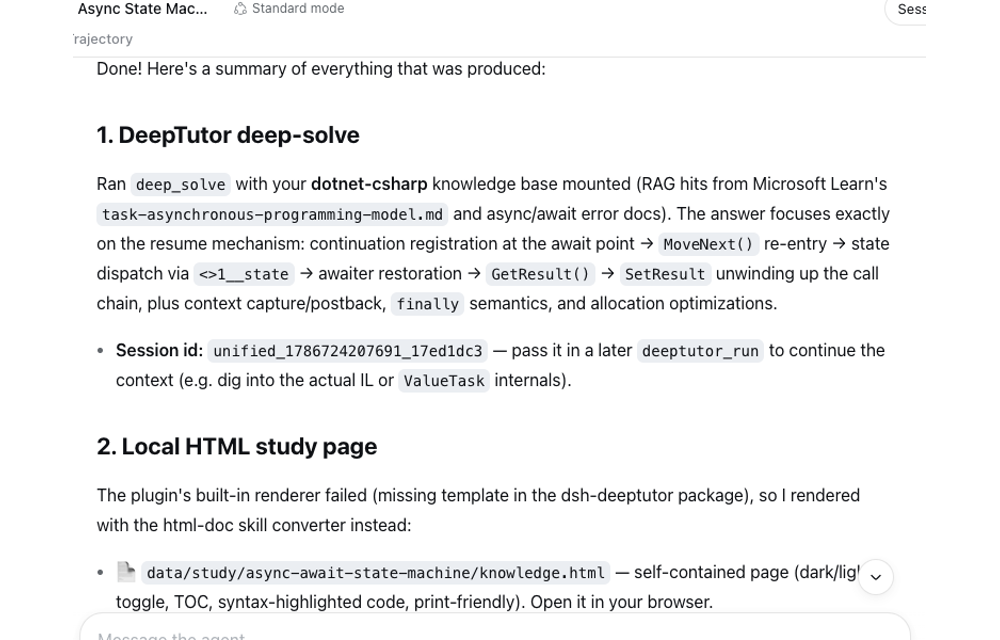
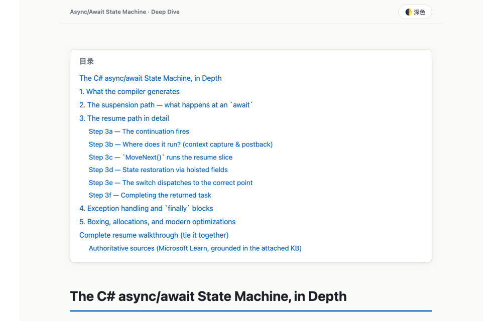

# dsh-deeptutor

**English** | [简体中文](https://github.com/TecFancy/dsh-deeptutor/blob/main/README.zh.md)

A **learning-assistant extension for DeepSeek Harness (dsh) and Claude Code**.
It connects your agent to a [HKUDS/DeepTutor](https://github.com/HKUDS/DeepTutor)
tutoring service, so a session can explain topics in depth, quiz you, plan
learning paths, search your personal knowledge bases, and keep a study
notebook, all without leaving the agent. In dsh it loads as a bundle; in
Claude Code (or any MCP client) the same tools are served by a bundled MCP
server, installed as a Claude Code plugin.

Ask the agent *"teach me async/await"* and it can run a deep-solve, render the
answer as a self-contained HTML study page you can open in a browser, and
archive a summary into your notebook.

## What it adds

Four agent-facing tools that the model uses whenever you ask for learning help:

| Tool | What it does |
|---|---|
| `deeptutor_run` | Runs one learning capability, e.g. `deep_solve` (in-depth explanation), `deep_question` (self-test questions), `deep_research`, `chat`, `mastery_path` (learning-path planning), `visualize`. Can mount your knowledge bases (`kbs`) and tools (`rag`, `web_search`, `reason`, `code_execution`, …); returns a `session_id` so later turns continue the same context, and can render the answer to an HTML study page. |
| `deeptutor_kb` | Lists, searches, and inspects your personal knowledge bases (RAG) |
| `deeptutor_note` | Archives Markdown study notes (plans, summaries, wrong answers) into a server notebook |
| `deeptutor_cli` | Runs any other DeepTutor CLI command, behind safety tiers (below) |

### Following DeepTutor upgrades without plugin releases

The plugin does not mirror DeepTutor's command surface, so a DeepTutor upgrade
that adds commands, capabilities or tools needs no plugin change:

- **Capabilities are discovered at runtime.** `deeptutor_run` takes any
  capability name. The plugin reads `deeptutor module list` (JSON, cached for
  five minutes) to learn which capabilities the deployment's ready modules
  provide; a capability whose module is not ready fails fast with the reason and
  the list of available ones, and names no module lists are passed straight to
  the CLI (they may come from a DeepTutor plugin).
- **Every other command goes through `deeptutor_cli`.** The agent discovers
  commands from the CLI itself (`args: ["--help"]`, then `["kb", "--help"]`, …)
  instead of a list baked into the plugin. Safety tiers keep the passthrough
  honest about commands it has never seen:

  | Tier | Commands | Behaviour |
  |---|---|---|
  | read | `--help`, verbs `list` / `show` / `info` / `search` / `state` / `status` / `list-*`, `doctor`, `run` | runs directly |
  | confirm | everything else, including verbs the plugin does not know yet | runs only with `confirm: true`, which the agent may set only after you explicitly asked for that change |
  | blocked | `delete`, `remove*`, `clear`, `uninstall`, `rollback`, `login`, …; interactive or long-running `chat` / `start` / `stop` / `serve` / `init` | refused; run them in a terminal yourself |

- **Drift check.** Only the few CLI shapes the dedicated tools are built on
  (`run --format json` events, `kb search`, `notebook add-md`, `module list`)
  can break the plugin. `npm run check:cli` checks them against the deployment
  your env vars point at; run it after upgrading DeepTutor.

## Example session

A typical flow when you ask your agent for learning help:

1. **Ask** — *"Explain C# generics covariance using my dotnet knowledge base, and generate a study page."*
2. The agent grounds the answer in your own material: `deeptutor_kb` (`action=search`, `kb=dotnet`).
3. It runs a deep-solve: `deeptutor_run` (`capability=deep_solve`, `kbs=[dotnet]`, `html=/home/me/study/csharp-covariance.html`) — the answer comes back and a self-contained HTML page (plus the `.md` source) is written to disk. The `html` path must be absolute; relative paths are rejected.
4. It files a summary: `deeptutor_note` (`notebook=dotnet-learning`, `type=solve`).

Nothing here is a fixed script — the agent picks the tools and parameters based
on what you ask for.

A real recording of exactly this flow (deep-solve on the async/await state
machine, mounted on a `dotnet-csharp` knowledge base, rendered to an HTML
study page, then archived to a notebook):





## Requirements

- An agent host: Claude Code (or another MCP client) with Node ≥ 20, or a
  working DeepSeek Harness (dsh) install, 0.1.0-rc.6 or newer. The manifest
  declares a version floor rather than a ceiling, so a new dsh release is never
  refused at install time; a scheduled probe boots the plugin against the
  current npm `latest` and `next` hosts instead and opens an issue when
  activation breaks. Bundle auto-registration via `dsh plugin add` was verified
  on dsh CLI 0.1.0-rc.6, 0.2.1-rc.2 and 0.2.1-rc.3.
- A DeepTutor deployment, either:
  - **Local** — the `deeptutor` CLI installed on this machine (on `PATH`, or
    pointed to by `DEEPTUTOR_LOCAL_BIN`);
  - **Remote** — DeepTutor installed on a server you can reach with
    passwordless SSH; the plugin runs the server's CLI over SSH.

  Tested against DeepTutor 1.7.1. Since 1.7 the `kb` and `notebook` commands
  and most capabilities come from optional modules; check that the ones you
  use are installed and enabled with `deeptutor module list`.

## Install into Claude Code (plugin)

This repo is also a Claude Code plugin marketplace. Inside Claude Code:

```text
/plugin marketplace add TecFancy/dsh-deeptutor
/plugin install dsh-deeptutor@dsh-deeptutor
```

or from a shell:

```sh
claude plugin marketplace add TecFancy/dsh-deeptutor
claude plugin install dsh-deeptutor@dsh-deeptutor
```

The plugin brings the two skills (`deeptutor`, `html-doc`) and an MCP server
named `deeptutor` that serves the four tools (Claude Code shows them as
`mcp__plugin_dsh-deeptutor_deeptutor__deeptutor_run` and so on). Set the
`DEEPTUTOR_*` env vars (see [Configuration](#configuration-env-vars-agent-agnostic))
where Claude Code can inherit them, then restart Claude Code.

The server is started by `scripts/mcp-launch.mjs`, which picks the first entry
that works: compiled `lib/` → the plugin's own `src/` via Node's type stripping
(Node ≥ 22.6, no network) → `npx dsh-deeptutor@<plugin version>` for older Node.
Either way the server runs the code of the installed plugin version.

**Other MCP clients** (Codex, Cursor, …) can run the published bin directly:

```json
{ "command": "npx", "args": ["-y", "-p", "dsh-deeptutor", "dsh-deeptutor-mcp"] }
```

## Install into a dsh profile (bundle)

The package is published to npm as `dsh-deeptutor`. Recommended one-liner —
runs the bundled installer (`scripts/install-profile.mjs`, exposed as the
`dsh-deeptutor` binary), which wraps `dsh plugin add` and automatically
handles the pnpm workspace-root check described below:

```sh
pnpm dlx dsh-deeptutor --profile web
```

From a checkout of this repo, the same installer runs directly:

```sh
node scripts/install-profile.mjs --profile web
```

Or run the underlying command yourself — `dsh plugin add` forwards to pnpm
and then reconciles the profile's `dsh.profile.bundles` against the installed
state, so a `dsh.bundle`-declaring package like this one is registered
automatically:

```sh
dsh plugin --profile web add dsh-deeptutor -w
```

> **Pitfall — pnpm workspace-root check.** The dsh profile scaffold always
> writes a `pnpm-workspace.yaml` (`packages: ["."]`, `nodeLinker: hoisted`),
> which makes the profile directory itself a pnpm workspace root. On
> pnpm ≥ 8, `pnpm add` in a workspace root aborts with
> `ERR_PNPM_ADDING_TO_ROOT` unless the workspace-root flag is explicit, so
> the command above appends `-w`/`--workspace-root` (pnpm prints this error
> on stdout on Windows, which is why a plain `dsh plugin add` without the
> flag fails even though the output looks like a warning). Two ways to
> handle it:
>
> 1. Use the installer / keep `-w` in the command (recommended — the
>    installer tries the plain command first and adds `-w` automatically
>    only when the check trips).
> 2. Or allow the plain command permanently: add
>    `ignore-workspace-root-check: true` to
>    `~/.dsh/profiles/<name>/pnpm-workspace.yaml`, then
>    `dsh plugin --profile web add dsh-deeptutor` works as written.

Verify the bundle is mounted, then restart dsh (the bundle list is resolved
at boot):

```sh
dsh --profile web --dump-config | grep dsh-deeptutor
```

If your dsh CLI does not auto-register the bundle (older versions, or you
installed the dependency manually), add it to the profile manifest
(`~/.dsh/profiles/<name>/package.json`) and run `dsh plugin --profile web
install`:

```json
{
  "dependencies": { "dsh-deeptutor": "^0.3.1" },
  "dsh": {
    "profile": { "bundles": ["@deepseek-ai/dsh-base", "@deepseek-ai/dsh-web-app", "dsh-deeptutor"] }
  }
}
```

Alternatively, keep the manifest untouched and mount the bundle through a user
patch layer (the npm package still has to be installed first):

```yaml
# overlay.yml — insert the bundle row via a user patch layer
- insert:
    - id: dsh-deeptutor
      name: 'dsh-deeptutor'
```

```sh
dsh web --patch ./overlay.yml
```

The bundle manifest (`dsh.bundle.patch → cordis.patch.yml`) inserts the plugin
row; later patch layers can override or disable it by id.

## Skills

Two skills ship inside this package (`.agents/skills/deeptutor` and
`.agents/skills/html-doc`) and the bundled installer copies them to
`<DSH_HOME>/skills/<name>/` (auto-discovered by dsh) whenever it runs — so
`pnpm dlx dsh-deeptutor` installs the bundle **and** the skills in one shot:

- `deeptutor` — the agent-facing learning workflow (`~/.dsh/skills/deeptutor/SKILL.md`)
- `html-doc` — renders study answers to self-contained HTML pages
  (`~/.dsh/skills/html-doc/`); when `deeptutor_run` gets an `html` path, the
  converter and template are resolved as `$HTML_DOC_SCRIPT` /
  `$HTML_DOC_TEMPLATE` → the installed skill above → the copy bundled in this
  package. Editing the installed template (say, wiring KaTeX in) changes the
  next render without patching the plugin, and the tool result prints which
  layer supplied each file. The `html` path itself must be absolute.

Installing a newer package version overwrites skill files in place; files not
shipped by the package are never deleted.

The Claude Code plugin loads the same skills straight from `.agents/skills/`.
The skills are maintained in this repo under `.agents/skills/`.

## Configuration (env vars, agent-agnostic)

```bash
# Remote deployment (DeepTutor on a server, driven over SSH)
export DEEPTUTOR_SSH_HOST="tencent-cloud"           # SSH host alias (set = remote mode)
export DEEPTUTOR_REMOTE_BIN="/home/ubuntu/my-deeptutor/.venv/bin/deeptutor"
export DEEPTUTOR_REMOTE_HOME="/home/ubuntu/my-deeptutor"

# Local deployment — leave DEEPTUTOR_SSH_HOST unset
# export DEEPTUTOR_LOCAL_BIN="deeptutor"             # local CLI path (default: deeptutor on PATH)
```

Restart dsh or Claude Code after changing env vars.

**Windows, local mode:** point `DEEPTUTOR_LOCAL_BIN` at `deeptutor.exe`
(for a pip/venv install: `<venv>\Scripts\deeptutor.exe`). A `.cmd`/`.bat`
wrapper also works: one that only forwards `%*` to an `.exe` is bypassed and
the `.exe` is run directly; any other wrapper runs through `cmd.exe`, which
cannot pass multi-line prompts, so those calls fail with a hint to use the
`.exe`.

## How it works

Every tool call drives the DeepTutor CLI: the local `deeptutor` binary, or the
remote binary over SSH when `DEEPTUTOR_SSH_HOST` is set. `deeptutor serve` does
not need to be reachable from this machine.

Earlier versions tried the HTTP/WebSocket API first (`/api/v1/...` through an
SSH tunnel) and only then fell back to the CLI. DeepTutor 1.7 serves those
routes under different paths and behind a login, so the probe always failed
and each call waited about 30 seconds before reaching the CLI. That path was
removed; `DEEPTUTOR_API_BASE` is no longer read.

## Develop against a checkout (no publish needed)

```sh
dsh web --patch /path/to/dsh-deeptutor/cordis.yml
```

## Build & publish

```sh
npm install
npm run build        # tsc → lib/ (relative .ts imports rewritten to .js)
npm run typecheck
npm test             # node:test + type stripping
npm run check:cli    # drift check against the live DeepTutor your env vars point at
claude plugin validate . --strict   # Claude Code plugin + marketplace manifests
npm pack             # inspect dsh-deeptutor-<version>.tgz
npm publish          # set a scope/registry of your choice first
```

Node ≥ 22.6 (type stripping) is needed to load the raw `src/*.ts` via
`--patch`; the published bundle ships compiled `lib/`, so installed profiles
run on plain Node ≥ 20 ESM.

## Layout

```
src/                 # TypeScript sources (dev loading, typecheck)
lib/                 # compiled ESM (published entry, from `npm run build`)
scripts/md-to-html.js  # zero-dependency Markdown → HTML converter
scripts/install-profile.mjs  # one-shot profile installer (exposed as the `dsh-deeptutor` binary)
scripts/mcp-launch.mjs # starts the MCP server for the Claude Code plugin
scripts/check-cli.ts   # drift check against a live DeepTutor (`npm run check:cli`)
.agents/skills/       # bundled skills: deeptutor/ + html-doc/ (installed to <DSH_HOME>/skills/)
.claude-plugin/       # Claude Code plugin.json (skills + MCP server) + marketplace.json
cordis.yml           # dev overlay: insert src/index.ts by absolute path
cordis.patch.yml     # bundle patch: insert the package by name
```

`src/tools.ts` defines the four tools once, host-neutral; `index.ts` registers
them in dsh; `mcp.ts` serves them over MCP stdio (`mcp-main.ts` is the
`dsh-deeptutor-mcp` bin); `cli-policy.ts` holds the `deeptutor_cli` safety
tiers; `discovery.ts` capability discovery; `config.ts` holds env config;
`cli-exec.ts` local/SSH CLI execution; `win-cmd.ts` starting a `.cmd`/`.bat` CLI on Windows;
`turn.ts` one learning turn (CLI JSONL event folding + formatting);
`html-render.ts` answer → self-contained HTML.
