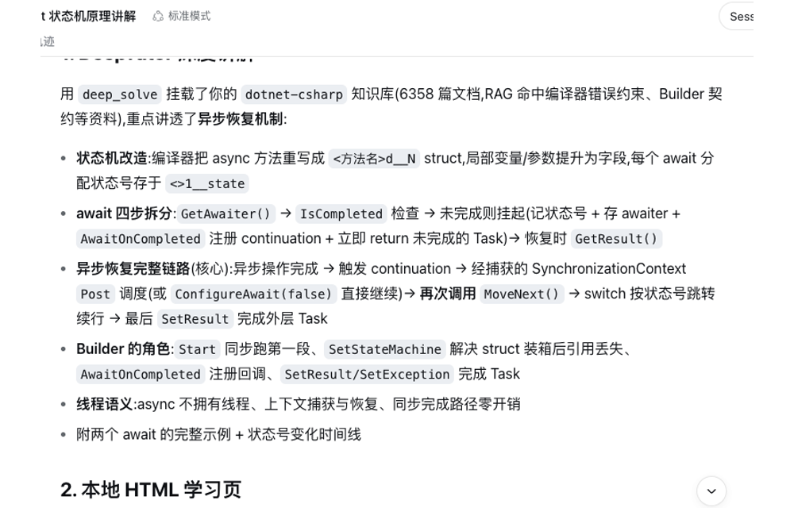
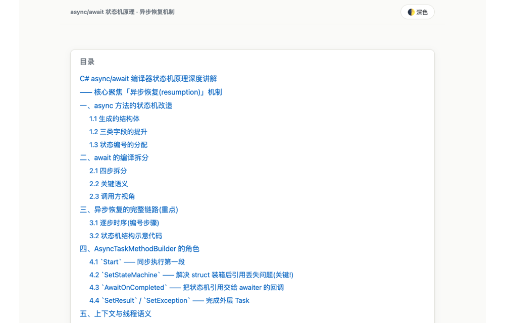

# dsh-deeptutor

[English](https://github.com/TecFancy/dsh-deeptutor/blob/main/README.md) | **简体中文**

面向 **DeepSeek Harness (dsh) 和 Claude Code** 的**学习辅助扩展**。它将 [HKUDS/DeepTutor](https://github.com/HKUDS/DeepTutor) 辅导服务接入你的 agent,让会话能够深度讲解知识点、出题自测、规划学习路径、检索你的个人知识库,并把学习笔记归档到 notebook,全程不出 agent。在 dsh 里它作为 bundle 加载;在 Claude Code(或任何 MCP 客户端)里,同一组工具由随包的 MCP server 提供,以 Claude Code 插件的形式安装。

只要对 agent 说 *"给我讲讲 async/await"*,它就能跑一次 deep-solve,把答案渲染成可在浏览器打开的自包含 HTML 学习页,再把摘要归档进你的笔记本。

## 它带来什么

四个 agent 可见工具,当你请求学习帮助时由模型调用:

| 工具 | 作用 |
|---|---|
| `deeptutor_run` | 执行一次学习调用,例如 `deep_solve`(深度讲解)、`deep_question`(自测题)、`deep_research`、`chat`、`mastery_path`(学习路径规划)、`visualize`。可挂载你的知识库(`kbs`)与工具(`rag`、`web_search`、`reason`、`code_execution` 等);返回 `session_id`,后续轮次可延续同一上下文,还能把答案渲染成 HTML 学习页。 |
| `deeptutor_kb` | 列出 / 搜索 / 查看你的个人知识库(RAG) |
| `deeptutor_note` | 把 Markdown 学习笔记(计划、总结、错题等)归档到服务器 notebook |
| `deeptutor_cli` | 执行 DeepTutor CLI 的其他任意命令,受下文的安全分级约束 |

### DeepTutor 升级时插件不用跟着发版

插件不再照抄 DeepTutor 的命令面,所以 DeepTutor 新增命令、capability 或工具时,插件不用改:

- **capability 运行时发现。** `deeptutor_run` 接受任意 capability 名。插件读取 `deeptutor module list`(JSON,缓存 5 分钟),得知部署上已就绪的模块提供哪些 capability;所属模块没就绪的 capability 会立即失败,并给出原因和当前可用列表;没有任何模块列出的名字直接交给 CLI(可能来自 DeepTutor 插件)。
- **其余命令都走 `deeptutor_cli`。** agent 从 CLI 自己查命令(`args: ["--help"]`,再 `["kb", "--help"]` 等),不依赖插件里写死的清单。安全分级保证透传对没见过的命令也有分寸:

  | 档位 | 命令 | 行为 |
  |---|---|---|
  | read | `--help`,动词为 `list` / `show` / `info` / `search` / `state` / `status` / `list-*` 的命令,`doctor`、`run` | 直接执行 |
  | confirm | 其余所有命令,包括插件还不认识的动词 | 需要 `confirm: true`,agent 只有在你明确要求这项改动后才能设 |
  | blocked | `delete`、`remove*`、`clear`、`uninstall`、`rollback`、`login` 等;交互式或常驻的 `chat` / `start` / `stop` / `serve` / `init` | 拒绝执行,请自己在终端里跑 |

- **漂移检查。** 能让插件失效的只有专用工具依赖的少数几处 CLI 形状(`run --format json` 的事件、`kb search`、`notebook add-md`、`module list`)。`npm run check:cli` 会对环境变量指向的部署逐项检查;升级 DeepTutor 后跑一次。

## 示例会话

一次典型的"求学习帮助"流程:

1. **提问** —— *"用我的 dotnet 知识库讲讲 C# 泛型协变,并生成学习页。"*
2. agent 先检索你的自有资料:`deeptutor_kb`(`action=search`,`kb=dotnet`)。
3. 再执行深度讲解:`deeptutor_run`(`capability=deep_solve`,`kbs=[dotnet]`,`html=/home/me/study/csharp-covariance.html`)—— 答案返回的同时,自包含 HTML 学习页(及配套 `.md` 源文件)写入磁盘。`html` 必须是绝对路径,相对路径会被拒绝。
4. 最后归档摘要:`deeptutor_note`(`notebook=dotnet-learning`,`type=solve`)。

以上不是固定脚本 —— agent 会根据你的提问自由选择工具与参数。

以下是该流程的真实录制(async/await 状态机 deep-solve,挂载 `dotnet-csharp` 知识库,渲染 HTML 学习页,归档笔记本):





## 环境要求

- 一个 agent 宿主:Claude Code(或其他 MCP 客户端)加 Node ≥ 20,或者可用的 DeepSeek Harness (dsh) 安装,0.1.0-rc.6 或更新版本。清单里只写下限不写上限,新版本 dsh 发布后不会再在安装时被拒绝;替代办法是定时拿 npm 上 `latest` 和 `next` 两个通道的宿主各冷启动一次,插件起不来就开 issue。`dsh plugin add` 自动登记 bundle 已在 dsh CLI 0.1.0-rc.6、0.2.1-rc.2 与 0.2.1-rc.3 上验证。
- 一个 DeepTutor 部署,二选一:
  - **本地** —— 本机装有 `deeptutor` CLI(在 PATH 上,或由 `DEEPTUTOR_LOCAL_BIN` 指定);
  - **远程** —— DeepTutor 装在一台能免密 SSH 登录的服务器上,插件经 SSH 调用服务器上的 CLI。

  已在 DeepTutor 1.7.1 上验证。从 1.7 起,`kb`、`notebook` 命令和大部分 capability 由可选模块提供,用 `deeptutor module list` 确认要用的模块已安装并启用。

## 安装到 Claude Code(插件方式)

本仓库同时是一个 Claude Code 插件 marketplace。在 Claude Code 里:

```text
/plugin marketplace add TecFancy/dsh-deeptutor
/plugin install dsh-deeptutor@dsh-deeptutor
```

或者在 shell 里:

```sh
claude plugin marketplace add TecFancy/dsh-deeptutor
claude plugin install dsh-deeptutor@dsh-deeptutor
```

插件带来两个 skill(`deeptutor`、`html-doc`)和一个名为 `deeptutor` 的 MCP server,提供上面四个工具(Claude Code 里显示为 `mcp__plugin_dsh-deeptutor_deeptutor__deeptutor_run` 等)。把 `DEEPTUTOR_*` 环境变量设在 Claude Code 能继承到的地方(见[配置](#配置环境变量与-agent-无关)),然后重启 Claude Code。

MCP server 由 `scripts/mcp-launch.mjs` 启动,按顺序取第一个可用的入口:编译好的 `lib/` → 插件自带的 `src/`,用 Node 的类型剥离直接运行(Node ≥ 22.6,不联网)→ 旧版 Node 时用 `npx dsh-deeptutor@<插件版本>`。无论哪条路,跑的都是已安装插件那个版本的代码。

**其他 MCP 客户端**(Codex、Cursor 等)可以直接运行发布出去的 bin:

```json
{ "command": "npx", "args": ["-y", "-p", "dsh-deeptutor", "dsh-deeptutor-mcp"] }
```

## 安装到 dsh profile(bundle 方式)

包已发布到 npm(`dsh-deeptutor`)。推荐一条命令 —— 运行随包发布的安装器(`scripts/install-profile.mjs`,以 `dsh-deeptutor` 二进制暴露),它包装 `dsh plugin add` 并自动处理下文所述的 pnpm workspace-root 检查:

```sh
pnpm dlx dsh-deeptutor --profile web
```

从本仓库检出目录运行同一个安装器:

```sh
node scripts/install-profile.mjs --profile web
```

或者自己执行底层命令:`dsh plugin add` 会转发给 pnpm 安装依赖,并把 profile 的 `dsh.profile.bundles` 与已安装状态对账,因此声明了 `dsh.bundle` 的包(如本插件)会被自动登记:

```sh
dsh plugin --profile web add dsh-deeptutor -w
```

> **坑:pnpm workspace-root 检查。** dsh 的 profile 脚手架**总是**写入 `pnpm-workspace.yaml`(`packages: ["."]`、`nodeLinker: hoisted`),profile 目录本身就是 pnpm workspace 根。在 pnpm ≥ 8 上,`pnpm add` 在 workspace 根目录执行会因 `ERR_PNPM_ADDING_TO_ROOT` 中止,必须显式加 workspace-root 标志,所以上面的命令追加了 `-w`/`--workspace-root`(注意:Windows 上 pnpm 把这条错误打在 **stdout**,看起来像警告,实际是失败)。两种处理方式:
>
> 1. 使用安装器 / 命令保留 `-w`(推荐 —— 安装器先试裸命令,只有检查触发时才自动补 `-w`)。
> 2. 或者永久放行裸命令:在 `~/.dsh/profiles/<name>/pnpm-workspace.yaml` 中加入 `ignore-workspace-root-check: true`,之后 `dsh plugin --profile web add dsh-deeptutor` 按原样即可。

验证挂载,然后重启 dsh(bundle 列表在启动时解析):

```sh
dsh --profile web --dump-config | grep dsh-deeptutor
```

如果你的 dsh CLI 不会自动登记 bundle(旧版本,或手动安装依赖),请在 profile 清单(`~/.dsh/profiles/<name>/package.json`)中手动加入,再运行 `dsh plugin --profile web install`:

```json
{
  "dependencies": { "dsh-deeptutor": "^0.3.1" },
  "dsh": {
    "profile": { "bundles": ["@deepseek-ai/dsh-base", "@deepseek-ai/dsh-web-app", "dsh-deeptutor"] }
  }
}
```

也可以不动清单,改用用户 patch 层挂载 bundle(仍需先安装 npm 包):

```yaml
# overlay.yml —— 通过用户 patch 层插入 bundle 行
- insert:
    - id: dsh-deeptutor
      name: 'dsh-deeptutor'
```

```sh
dsh web --patch ./overlay.yml
```

bundle 清单(`dsh.bundle.patch → cordis.patch.yml`)负责插入插件行;上层 patch 层可按 id 覆盖或禁用。

## Skills

本包携带两个 skill(`.agents/skills/deeptutor` 与 `.agents/skills/html-doc`),随包安装器每次运行时都会把它们复制到 `<DSH_HOME>/skills/<name>/`(dsh 自动发现)—— 所以 `pnpm dlx dsh-deeptutor` 一次装齐插件 **和** skill:

- `deeptutor` — 面向 agent 的学习工作流(`~/.dsh/skills/deeptutor/SKILL.md`)
- `html-doc` — 将学习内容渲染为自包含 HTML 页面(`~/.dsh/skills/html-doc/`);`deeptutor_run` 传入 `html` 时,转换器与模板按 `$HTML_DOC_SCRIPT` / `$HTML_DOC_TEMPLATE` → 上面这个已安装 skill → 包内副本的顺序解析。改已安装模板(例如真正接上 KaTeX)下次渲染即生效,不用改插件包;工具结果会打印每层实际用的文件。`html` 路径必须是绝对路径。

升级包版本时会就地覆盖 skill 文件;包未携带的文件不会被删除。

Claude Code 插件直接从 `.agents/skills/` 加载同一份 skill。skill 就在本仓库的 `.agents/skills/` 下维护。

## 配置(环境变量,与 agent 无关)

```bash
# 远程部署(DeepTutor 在服务器上,经 SSH 调用)
export DEEPTUTOR_SSH_HOST="tencent-cloud"           # SSH 主机别名(设置 = 远程模式)
export DEEPTUTOR_REMOTE_BIN="/home/ubuntu/my-deeptutor/.venv/bin/deeptutor"
export DEEPTUTOR_REMOTE_HOME="/home/ubuntu/my-deeptutor"

# 本地部署 —— 不要设置 DEEPTUTOR_SSH_HOST
# export DEEPTUTOR_LOCAL_BIN="deeptutor"             # 本地 CLI 路径(默认: PATH 上的 deeptutor)
```

修改环境变量后需重启 dsh 或 Claude Code。

**Windows 本地模式:** 把 `DEEPTUTOR_LOCAL_BIN` 指向 `deeptutor.exe`(pip/venv 安装时是 `<venv>\Scripts\deeptutor.exe`)。`.cmd`/`.bat` 包装脚本也能用:只把 `%*` 转给某个 `.exe` 的包装脚本会被绕过,直接运行那个 `.exe`;其他包装脚本经 `cmd.exe` 运行,而 `cmd.exe` 传不了多行提示词,这类调用会报错并提示改用 `.exe`。

## 工作原理

每次工具调用都走 DeepTutor CLI:本地的 `deeptutor` 二进制,或在设置了 `DEEPTUTOR_SSH_HOST` 时经 SSH 调用远程二进制。本机不需要能访问 `deeptutor serve`。

早期版本先尝试 HTTP/WebSocket API(经 SSH 隧道访问 `/api/v1/...`),失败后才回退到 CLI。DeepTutor 1.7 的这些接口换了路径并要求登录,探测总是失败,每次调用都要先等约 30 秒才轮到 CLI。这条路径已移除,`DEEPTUTOR_API_BASE` 不再读取。

## 源码开发(无需发布)

```sh
dsh web --patch /path/to/dsh-deeptutor/cordis.yml
```

## 构建与发布

```sh
npm install
npm run build        # tsc → lib/(相对 .ts import 改写为 .js)
npm run typecheck
npm test             # node:test + type stripping
npm run check:cli    # 对环境变量指向的 DeepTutor 做漂移检查
claude plugin validate . --strict   # 校验 Claude Code 插件和 marketplace 清单
npm pack             # 检查 dsh-deeptutor-<version>.tgz
npm publish
```

通过 `--patch` 直接加载 `src/*.ts` 需要 Node ≥ 22.6(type stripping);发布的 bundle 自带编译后的 `lib/`,安装到 profile 后仅需普通 Node ≥ 20 ESM。

## 目录结构

```
src/                 # TypeScript 源码(开发加载、类型检查)
lib/                 # 编译产物(发布入口,由 npm run build 生成)
scripts/md-to-html.js  # 零依赖 Markdown → HTML 转换器
scripts/install-profile.mjs  # 一键 profile 安装器(以 `dsh-deeptutor` 二进制暴露)
scripts/mcp-launch.mjs # 为 Claude Code 插件启动 MCP server
scripts/check-cli.ts   # 对真实 DeepTutor 的漂移检查(`npm run check:cli`)
.agents/skills/       # 随包 skill:deeptutor/ + html-doc/(安装到 <DSH_HOME>/skills/)
.claude-plugin/       # Claude Code 的 plugin.json(skill 和 MCP server)和 marketplace.json
cordis.yml           # 开发 overlay:按绝对路径插入 src/index.ts
cordis.patch.yml     # bundle patch:按包名插入插件
```

`src/tools.ts` 定义四个工具,与宿主无关;`index.ts` 在 dsh 里注册它们;`mcp.ts` 经 MCP stdio 提供它们(`mcp-main.ts` 是 `dsh-deeptutor-mcp` bin 的入口);`cli-policy.ts` 是 `deeptutor_cli` 的安全分级;`discovery.ts` 负责 capability 发现;`config.ts` 环境配置;`cli-exec.ts` 本地/SSH CLI 执行;`win-cmd.ts` 在 Windows 上启动 `.cmd`/`.bat` 形式的 CLI;`turn.ts` 单次学习回合(CLI JSONL 事件折叠与格式化);`html-render.ts` 答案 → 自包含 HTML。
